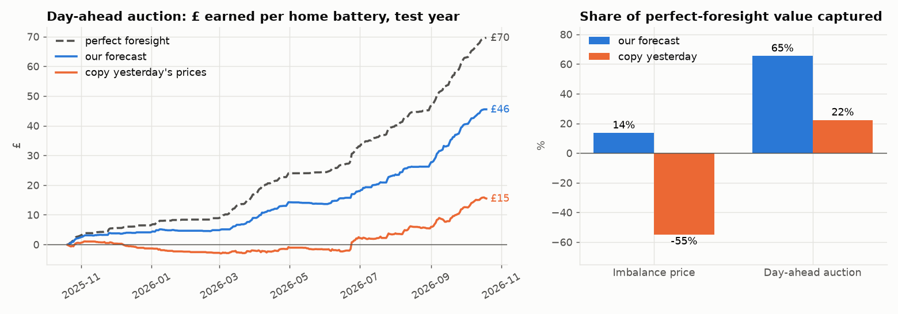
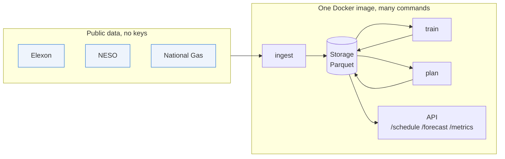

# flexcast

**Can a forecast make a home battery money on Britain's electricity market, and how much?**

Every morning at 09:00, flexcast predicts tomorrow's hourly electricity prices, plans when a home
battery (10 kWh, 5 kW) should charge and discharge, and commits that plan to the **day-ahead
auction**, which closes at 09:50. A year-long backtest measures what the plan earns against two
yardsticks: perfect knowledge of tomorrow's prices (the most anyone could earn), and simply
copying yesterday's prices (the bar to beat).

**Result, over a held-out test year (Oct 2025 to Oct 2026):** the forecast earns **£45.50 per
battery per year**, **65% of the perfect-foresight value (£69.61)** and **3× the naive strategy
(£15.48, 22%)**. Against the harder imbalance price, settled after the fact, the same approach
captures only 14%, and naive copying *loses* money. That gap is why the project trades in
advance.



> £45 a year per battery is small on its own. The business case is scale: 100,000 batteries
> ≈ £4.5m a year, before price impact (see [Limitations](#limitations-and-gaps)). That is the
> model an **aggregator** runs: a single home battery is far too small to trade in the auction
> itself.

**Status:** model, pipeline, containers, CI and write-up are done. Cloud deployment (Stage 5) and
the optional fleet-telemetry stage (6) are not built yet. See [SPEC.md](SPEC.md) for the stages and
[docs/journal.md](docs/journal.md) for what each one taught.

---

## How it works

1. **Ingest** public data into date-partitioned Parquet files: prices, demand and wind forecasts
   (Elexon), embedded solar and wind forecasts plus auction prices (NESO), and two candidate
   inputs, gas prices (National Gas) and power-station availability (Elexon).
2. **Build features as of 09:00 the day before.** Each record carries the time it was first
   published, and the feature code can only see records published before the decision. Every
   forecast is as old as it would really have been.
3. **Forecast** each hour's price as a range: a likely value plus 10th and 90th percentiles,
   from LightGBM quantile regression, retrained weekly. The range is then **calibrated** so that
   about 80% of real prices fall inside it.
4. **Optimise** the battery against the forecast with a mixed-integer program (PuLP + HiGHS). It
   allows for round-trip losses, a wear cost per kWh, one power level per auction hour, and no
   charging and discharging at once.
5. **Settle** the plan at the actual auction prices and score it in £.

### Architecture



| | Local laptop | Compose (local, emulated cloud) | GCP (Stage 5, planned) |
|---|---|---|---|
| Storage | `file://./data` | `gs://` on fake-gcs-server | Cloud Storage bucket |
| Upstream APIs | real | `upstream-mock` replaying recorded fixtures | real |
| Jobs | `uv run flexcast …` | `docker compose run` | Cloud Run Jobs + Cloud Scheduler |
| API | — | container | Cloud Run service |

The code is identical in every column; only environment variables change (`FLEXCAST_DATA_URI`,
upstream base URLs). All file access goes through one storage module.

---

## Results

Test year 2025-10-20 to 2026-10-19 (365 days), decision at D-1 09:00 London, battery 10 kWh /
5 kW / 90% round trip, wear cost 2p per kWh moved. Full tables:
[day-ahead](docs/results_day_ahead.md) · [imbalance](docs/results.md) ·
[every experiment](experiments/README.md).

| Market | Perfect foresight | Our forecast | % captured | Copy yesterday | Typical hourly miss | Range holds actual |
|---|---|---|---|---|---|---|
| **Day-ahead auction** | £69.61 | **£45.50** | **65%** | £15.48 (22%) | £12.4/MWh | 78% (target 80%) |
| Imbalance price | £270.73 | £36.61 | 14% | −£148.66 (−55%) | £30.5/MWh | 77% |

What moved the numbers (each step decided on a six-month validation window *before* the test
year, then logged):

| Step | £/yr | Note |
|---|---|---|
| Baseline model (imbalance) | 32.55 | 23 inputs, default settings |
| + embedded solar and wind forecasts | 33.93 | small, inside the noise |
| + tuning | 36.61 | heavy regularisation; it's a noisy target |
| + calibrated ranges | 36.61 | coverage 66% → 77%; £ unchanged |
| **Switch to the day-ahead auction** | **45.50** | yesterday's auction prices are known and repeat |
| + gas price / plant availability | 45.6–45.9 | **not adopted**: no validation gain ([notebook 07](notebooks/07_gas_and_availability.ipynb)) |

**Why the auction works so much better:** the battery only needs to know *which hours are cheap
and which are dear*. Within each day the forecast ranks the auction's hours almost perfectly
(median rank correlation 0.91, vs 0.50 for the imbalance price). The imbalance price's extra
value sits in spikes that nobody can see a day ahead.

**The wear-cost assumption matters as much as the model.** At 0p per kWh the forecast earns £201
(87% of perfect); at 4p only £7. A real deployment must pin this number down.

The notebooks tell the modelling story in order:
[01 prices](notebooks/01_explore_prices.ipynb) ·
[02 diagnosis](notebooks/02_diagnose_model.ipynb) ·
[03 solar](notebooks/03_solar_feature.ipynb) ·
[04 tuning](notebooks/04_tuning.ipynb) ·
[05 calibration](notebooks/05_calibration.ipynb) ·
[06 which market](notebooks/06_day_ahead_market.ipynb) ·
[07 gas and availability](notebooks/07_gas_and_availability.ipynb)

---

## Testing, and why local-first

| Layer | Runs | Proves | Command |
|---|---|---|---|
| **Unit** | plain Python, no network or Docker | optimiser constraints, clock-change days (46/50 half-hours), feature build, valuation maths, **leakage** | `make test` |
| **Integration** | Docker Compose with emulators | real HTTP clients against a mock upstream, the real cloud-storage client against an emulator, container entrypoints, API contract, idempotent re-ingest | `make itest` |
| **Live smoke** | opt-in; weekly in CI | the real upstream APIs haven't changed shape | `make live` |
| **Deployed smoke** | against GCP | permissions, schedules, service config | Stage 5 |

- **Leakage tests are the core.** One corrupts every value published after the decision time and
  asserts that no feature changes. Another checks that every source used was published before
  the decision, and a third pins each publication rule. Each test was **mutation-checked**: I
  broke the code on purpose to confirm the tests catch it. One mutation slipped through at first
  and led to a better test.
- **Recorded fixtures feed both unit tests and the mock server**, so the two can't drift.
- **Local-first** means every layer runs on a laptop before any cloud exists. The cloud stage
  only has to prove what is genuinely cloud-specific: permissions, scheduling and configuration.
- **CI** (GitHub Actions) runs lint, type checks and unit tests, then builds the image and runs
  the integration tests on every pull request and on `main`, which is protected.

---

## Design decisions

- **Day-ahead auction as the market,** decided by data (notebook 06): it offers less, but most of
  it can be captured, and the 09:50 bid deadline fixes the decision time.
- **Publication times, not data times.** Each source has a measured, documented rule for when a
  value became known ([docs/data-sources.md](docs/data-sources.md)). Some had to be measured
  directly: NESO republishes auction prices about 12:30 UK time, and the gas price for day d
  appears around 12:40 on d+1.
- **Gradient boosting with quantiles, not deep learning.** It suits tabular data with about two
  years of history. It's fast enough to retrain weekly over a full backtest, and easy to explain
  (SHAP).
- **Calibration fitted on past days only** (a rolling 90-day window). Fitting it on the days it
  is scored on would make the coverage look perfect by construction.
- **Decision rules set before looking.** New inputs and settings are adopted only if they improve
  both £ and accuracy on the validation window. The test year is reported, never chosen on. This
  is why gas, which helped accuracy *in the test year*, was not adopted.
- **£ is the headline metric.** Forecast accuracy matters only insofar as it moves £, and the two
  often disagree.
- **A lightweight experiment log in the repo** (`experiments/log.jsonl`) instead of MLflow: every
  logged run records its config, git commit and metrics.
- **Deliberately not built:** a front end beyond the API docs; streaming ingestion (a 30-minute
  batch is enough for a decision made the day before); Kubernetes, Airflow, Kafka, feature stores
  and BigQuery; multi-asset portfolio optimisation.

---

## Limitations and gaps

**About the result**
- **It's a backtest, not a trading record.** Nothing has traded or run live yet; the cloud
  deployment is still to come.
- **One test year and a short history** (data from October 2024). A six-month validation window
  can miss whole regimes: gas prices were flat during validation, then nearly tripled during the
  test year.
- **Price-taker assumption.** The battery is assumed to trade at the auction's clearing price
  without moving it. That holds for one battery but not for a large fleet, so the fleet figures
  are an upper bound.
- **The wear cost is a guess** (2p/kWh), and the result is very sensitive to it.

**About the battery and the household**
- One idealised battery that is always available and returns to half-charge each night, with no
  multi-day planning.
- No household demand, rooftop solar, tariffs or network charges. What a real home saves depends
  on all of these.
- The auction trades whole hours, but nothing is re-traded closer to real time (intraday or
  imbalance).

**About the data**
- Historical imbalance prices are the latest revised values, not what was first published.
- NESO's embedded forecasts have small archive gaps, and some timestamps had to be cross-checked
  and rejected.
- Gas prices come from an undocumented endpoint, which could change without notice. The weekly
  live check is there to catch that.

---

## Improvements and next steps

**Earn more from the same battery**
- **Re-trade after the auction:** adjust the plan intraday and against the imbalance price as
  forecasts improve. This chases the value the auction leaves behind.
- **Stack revenue:** grid balancing services (the Balancing Mechanism), frequency response, the
  Capacity Market and demand-flexibility events. For many real batteries these pay more than
  price arbitrage.
- **Plan across days** with a value on stored energy, rather than resetting every night.

**Model the real world better**
- **Portfolio bidding and price impact:** bid a fleet's combined curve and model how it moves the
  clearing price.
- **Asset availability forecasting:** predict which homes' batteries will actually be available,
  from household load, rooftop solar, EV charging and the owner's settings.
- **Location:** the wholesale price is national, but tariffs, network charges, local flexibility
  payments and rooftop solar all vary by region and home.

**Make the forecast stronger**
- **Longer history including the 2022 gas crisis** (auction prices go back to 2021): the proper
  test of gas and plant-availability inputs, which were built here but not adopted.
- **More of the inputs a commercial desk uses** ([docs/candidate-sources.md](docs/candidate-sources.md)):
  neighbouring countries' prices and nuclear output, grid bottlenecks, and multi-run weather
  forecasts.
- **Plan on scenarios, not just a range:** optimise against many sampled price paths.

**Operate it**
- Deploy to GCP (Stage 5), then build a live track record with *paper trading*: record the plan
  each day and settle it against real auction prices.

---

## Run it

Needs Docker and [uv](https://docs.astral.sh/uv/).

```sh
make up && make demo   # local stack with emulated cloud storage; load sample days, train, plan
open http://localhost:8080/docs        # e.g. /schedule?date=2025-06-11
make lint test itest   # checks, unit tests, integration tests (stack running)
make down
```

To reproduce the results: `make ingest START=2024-10-18 END=2026-10-20` (a backfill of about two
years from the public APIs), then `make backtest` (both markets) and `make notebooks`.

## Data and attribution

Contains BMRS data © Elexon Limited copyright and database right. Data from the
[NESO Data Portal](https://www.neso.energy/data-portal) and the
[National Gas data portal](https://data.nationalgas.com/), both published as open data (check each
portal's terms before commercial use). Tariff data from the
[Octopus Energy public API](https://developer.octopus.energy/).
