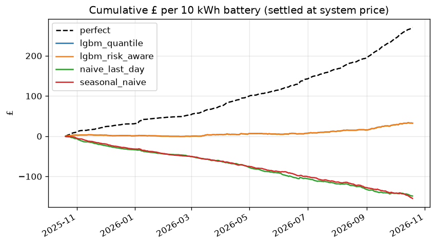

# Backtest results

Generated by `flexcast backtest`; do not edit by hand. Contains BMRS data © Elexon Limited
copyright and database right.

- Test window: 2025-10-20 to 2026-10-19 (365 days with
  complete prices; 0 skipped). Training from 2024-10-20, expanding
  window, retrained every 7 days.
- Decision: D-1 09:00 Europe/London. Features use only data available before it.
- Battery: 10 kWh, 5 kW, 90% round trip, SoC 5 kWh at start and end, degradation 2p/kWh throughput. Settled at the system sell price (single imbalance price).
- Strategies optimise the battery on their p50 forecast; `perfect` optimises on actual prices.
  Leaving the battery idle earns £0: a strategy below zero is worse than doing nothing.

## Summary

| strategy | days | £/battery/year | % of perfect | MAE £/MWh | pinball |
|---|---|---|---|---|---|
| perfect | 365 | 270.73 | 100.00 | 0.00 | 0.00 |
| lgbm_quantile | 365 | 32.55 | 12.02 | 30.59 | 9.79 |
| lgbm_risk_aware | 365 | 32.55 | 12.02 | 30.59 | 9.79 |
| naive_last_day | 365 | -148.66 | -54.91 | 44.31 | 22.15 |
| seasonal_naive | 365 | -154.79 | -57.17 | 45.45 | 22.72 |

## Fleet scaling (linear)

| strategy | 1,000 batteries (£k/yr) | 10,000 batteries (£k/yr) | 100,000 batteries (£k/yr) |
|---|---|---|---|
| lgbm_quantile | 33 | 326 | 3255 |
| lgbm_risk_aware | 33 | 326 | 3255 |
| naive_last_day | -149 | -1487 | -14866 |
| seasonal_naive | -155 | -1548 | -15479 |

Linear scaling ignores price impact: a 100k-battery fleet (500 MW) would move the prices it
trades against, so the 100k figure is an upper bound.

## Degradation sensitivity (£/battery/year; % of perfect in brackets)

| strategy | 0p/kWh | 1p/kWh | 2p/kWh | 4p/kWh |
|---|---|---|---|---|
| perfect | £634 (100%) | £416 (100%) | £271 (100%) | £123 (100%) |
| lgbm_quantile | £174 (27%) | £82 (20%) | £33 (12%) | £3 (3%) |
| lgbm_risk_aware | £174 (27%) | £82 (20%) | £33 (12%) | £3 (3%) |
| seasonal_naive | £7 (1%) | -£135 (-32%) | -£149 (-55%) | -£122 (-99%) |
| naive_last_day | -£2 (-0%) | -£145 (-35%) | -£155 (-57%) | -£122 (-100%) |

## Risk-aware scheduling

`lgbm_risk_aware` uses the `lgbm_quantile` forecast but plans as if buying at
p50 + α·(p90 − p50) and selling at p50 − α·(p50 − p10), so it only trades when a spread survives
the pessimistic end of the forecast range. It still settles at actual prices. α = 0 is the plain
p50 strategy.

α was chosen on the validation window 2025-04-21 to 2025-10-19 (before the test
window): **α = 0**.

Validation window (used to choose α):

| alpha | gbp_per_year | pct_of_perfect |
|---|---|---|
| alpha=0 | 24.58 | 10.30 |
| alpha=0.25 | 23.00 | 9.64 |
| alpha=0.5 | 7.37 | 3.09 |
| alpha=0.75 | 0.37 | 0.15 |
| alpha=1 | 0.00 | 0.00 |

Test window, all α (hindsight, shown for transparency only; not used to choose):

| alpha | gbp_per_year | pct_of_perfect |
|---|---|---|
| alpha=0 | 32.55 | 12.02 |
| alpha=0.25 | 27.88 | 10.30 |
| alpha=0.5 | 12.61 | 4.66 |
| alpha=0.75 | 3.30 | 1.22 |
| alpha=1 | 0.00 | 0.00 |

## Worst 10 days for `lgbm_quantile` (£ short of perfect foresight)

| target_date | perfect_gbp | lgbm_quantile_gbp | shortfall_gbp |
|---|---|---|---|
| 2026-06-23 | 5.52 | 0.00 | 5.52 |
| 2026-01-05 | 4.44 | 0.86 | 3.58 |
| 2026-01-08 | 3.19 | 0.00 | 3.19 |
| 2026-09-15 | 2.96 | -0.23 | 3.18 |
| 2026-10-04 | 1.97 | -0.60 | 2.56 |
| 2026-09-07 | 2.30 | -0.03 | 2.32 |
| 2026-09-30 | 2.43 | 0.21 | 2.21 |
| 2026-04-06 | 2.03 | -0.16 | 2.19 |
| 2026-09-22 | 2.20 | 0.08 | 2.12 |
| 2026-03-29 | 1.27 | -0.79 | 2.06 |

## Caveats

- Historical system prices are the latest settlement revision, not the first-published value;
  features may see slightly better prices than were available in real time.
- One representative battery; perfect execution; symmetric buy/sell price; no network charges.
- Degradation is a flat £/kWh throughput cost (see sensitivity table).
