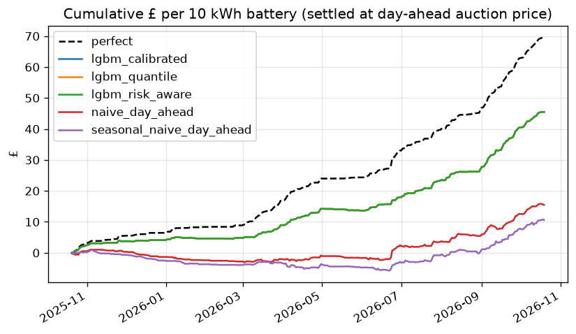

# Backtest results: day-ahead auction price

Generated by `flexcast backtest`; do not edit by hand. Contains BMRS data © Elexon Limited
copyright and database right.

- Test window: 2025-10-20 to 2026-10-19 (365 days with
  complete prices; 0 skipped). Training from 2024-10-20, expanding
  window, retrained every 7 days.
- Decision: D-1 09:00 Europe/London. Features use only data available before it.
- Battery: 10 kWh, 5 kW, 90% round trip, SoC 5 kWh at start and end, degradation 2p/kWh throughput, one power level per hour. Settled at the day-ahead auction price.
- Strategies optimise the battery on their p50 forecast; `perfect` optimises on actual prices.
  Leaving the battery idle earns £0: a strategy below zero is worse than doing nothing.

## Summary

| strategy | days | £/battery/year | % of perfect | MAE £/MWh | pinball | p10-p90 coverage |
|---|---|---|---|---|---|---|
| perfect | 365 | 69.61 | 100.00 | 0.00 | 0.00 | 1.00 |
| lgbm_calibrated | 365 | 45.50 | 65.37 | 12.43 | 3.91 | 0.78 |
| lgbm_quantile | 365 | 45.50 | 65.37 | 12.43 | 4.13 | 0.62 |
| lgbm_risk_aware | 365 | 45.50 | 65.37 | 12.43 | 3.91 | 0.78 |
| naive_day_ahead | 365 | 15.48 | 22.24 | 20.17 | 10.08 | 0.00 |
| seasonal_naive_day_ahead | 365 | 10.60 | 15.23 | 25.13 | 12.56 | 0.00 |

## Fleet scaling (linear)

| strategy | 1,000 batteries (£k/yr) | 10,000 batteries (£k/yr) | 100,000 batteries (£k/yr) |
|---|---|---|---|
| lgbm_calibrated | 46 | 455 | 4550 |
| lgbm_quantile | 46 | 455 | 4550 |
| lgbm_risk_aware | 46 | 455 | 4550 |
| naive_day_ahead | 15 | 155 | 1548 |
| seasonal_naive_day_ahead | 11 | 106 | 1060 |

Linear scaling ignores price impact: a 100k-battery fleet (500 MW) would move the prices it
trades against, so the 100k figure is an upper bound.

## Degradation sensitivity (£/battery/year; % of perfect in brackets)

| strategy | 0p/kWh | 1p/kWh | 2p/kWh | 4p/kWh |
|---|---|---|---|---|
| perfect | £232 (100%) | £127 (100%) | £70 (100%) | £22 (100%) |
| lgbm_calibrated | £201 (87%) | £98 (77%) | £46 (65%) | £7 (32%) |
| lgbm_quantile | £201 (87%) | £98 (77%) | £46 (65%) | £7 (32%) |
| lgbm_risk_aware | £201 (87%) | £98 (77%) | £46 (65%) | £7 (32%) |
| naive_day_ahead | £171 (74%) | £71 (56%) | £15 (22%) | -£15 (-70%) |
| seasonal_naive_day_ahead | £167 (72%) | £70 (55%) | £11 (15%) | -£21 (-97%) |

## Risk-aware scheduling

`lgbm_risk_aware` uses the `lgbm_calibrated` forecast but plans as if buying at
p50 + α·(p90 − p50) and selling at p50 − α·(p50 − p10), so it only trades when a spread survives
the pessimistic end of the forecast range. It still settles at actual prices. α = 0 is the plain
p50 strategy.

α was chosen on the validation window 2025-04-21 to 2025-10-19 (before the test
window): **α = 0**.

Validation window (used to choose α):

| alpha | gbp_per_year | pct_of_perfect |
|---|---|---|
| alpha=0 | 29.89 | 61.76 |
| alpha=0.25 | 25.18 | 52.03 |
| alpha=0.5 | 15.49 | 31.99 |
| alpha=0.75 | 9.92 | 20.49 |
| alpha=1 | 3.33 | 6.88 |

Test window, all α (hindsight, shown for transparency only; not used to choose):

| alpha | gbp_per_year | pct_of_perfect |
|---|---|---|
| alpha=0 | 45.50 | 65.37 |
| alpha=0.25 | 36.27 | 52.11 |
| alpha=0.5 | 24.89 | 35.75 |
| alpha=0.75 | 11.48 | 16.50 |
| alpha=1 | 4.45 | 6.39 |

## Worst 10 days for `lgbm_calibrated` (£ short of perfect foresight)

| target_date | perfect_gbp | lgbm_calibrated_gbp | shortfall_gbp |
|---|---|---|---|
| 2026-06-24 | 2.32 | 1.24 | 1.08 |
| 2026-06-23 | 0.83 | 0.00 | 0.83 |
| 2026-08-13 | 0.67 | 0.09 | 0.58 |
| 2026-09-22 | 1.28 | 0.71 | 0.57 |
| 2026-03-04 | 0.53 | 0.00 | 0.53 |
| 2026-03-10 | 0.49 | 0.00 | 0.49 |
| 2026-06-26 | 0.40 | 0.00 | 0.40 |
| 2026-04-04 | 0.73 | 0.33 | 0.40 |
| 2026-08-14 | 0.39 | 0.00 | 0.39 |
| 2026-03-15 | 0.51 | 0.13 | 0.38 |

## Caveats

- Historical system prices are the latest settlement revision, not the first-published value;
  features may see slightly better prices than were available in real time.
- One representative battery; perfect execution; symmetric buy/sell price; no network charges.
- Degradation is a flat £/kWh throughput cost (see sensitivity table).
